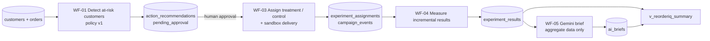

# ReOrder IQ: AI-assisted retention and profitable growth agent

> **All data in this project is synthetic and illustrative.** Customers, orders, campaign delivery and post-campaign reorders were generated for this project. Nothing here is real marketplace data, and the results demonstrate a measurement method, not a real-world finding.

ReOrder IQ is an end-to-end retention workflow for a **fictional UAE food-delivery marketplace**. It finds frequent customers whose ordering is slowing, chooses an action with fixed business rules, tests that action against a held-out control group, and uses Gemini only to *explain* the result. A human approves every action.

Built with **n8n, PostgreSQL / SQL and Google Gemini**.

## Headline result (simulated 14-day test)

| | Control | Treatment (reminder) |
|---|---|---|
| Customers | 179 | 149 |
| Reorder rate | 12.85% | 21.48% |

- **Lift:** +8.63 percentage points (95% interval +0.41 to +16.84).
- **Extra contribution:** about 8.23 AED per treated customer (95% interval 0.05 to 16.41); roughly 1,219 AED net after a 7.45 AED message cost.
- **Honest reading:** positive but moderate evidence with about 150 customers per group. The recommendation is a larger confirmation test, not an immediate rollout.

Data is generated randomly, so rerunning the scripts gives similar but not identical numbers.

## What this project demonstrates

- **Deterministic logic for decisions, AI only for explanation.** Eligibility, assignment and arithmetic are SQL and JavaScript rules. Gemini receives only aggregate results and returns a structured JSON brief.
- **Causal measurement, not just reporting.** Stable treatment/control assignment, then incremental reorders and contribution versus control, with 95% intervals.
- **Responsible-AI controls.** Marketing consent is a hard stop, no discount is given by default, every recommendation starts as `pending_approval`, and workflow reruns are safe (unique constraints, `ON CONFLICT DO NOTHING`).
- **Honest evaluation.** The AI rated its own confidence "high"; the statistics only support "moderate". The report flags this disagreement instead of hiding it.

## Architecture



| Workflow | Purpose |
|---|---|
| WF-01 Data and opportunity detection | Per-customer order metrics, at-risk flag, policy v1 action |
| WF-03 Approval and assignment | MD5-hash treatment/control split, sandbox delivery log (treatment only) |
| WF-04 Measure results | Reorder-rate lift, contribution per customer, 95% intervals, net contribution |
| WF-05 AI brief | One Gemini call on aggregates, stored as JSON for approval |

**Policy v1:** at risk = at least 6 orders in days 61-120 and at most half as many in the last 60 days. No consent means no action. Ordered in the last 7 days means suppressed. Otherwise: personalized reminder, 0% discount.

## Repository layout

```
sql/          Schema, synthetic data generator, and every query used by the workflows
n8n_code/     JavaScript Code-node logic and the Gemini prompt
workflows/    Exported n8n workflow JSON files (import these into n8n)
docs/         Project report (PDF) and screenshots
```

## How to run it

**Requirements:** Docker Desktop, n8n, PostgreSQL 16, a SQL client (for example DBeaver), and a free Google Gemini API key.

1. Start PostgreSQL (for example `docker run -d --name reorderiq-db -e POSTGRES_USER=reorder -e POSTGRES_PASSWORD=<choose-a-password> -e POSTGRES_DB=reorderiq -p 5433:5432 postgres:16`) and run `sql/01_schema.sql`, then `sql/02_seed_synthetic_data.sql` once.
2. Start n8n and add a Postgres credential (host `host.docker.internal`, port `5433`) and a Gemini credential. **Never commit credentials or API keys.**
3. Import the workflow files from `workflows/` into n8n.
4. Run **WF-01**. (Without n8n, `sql/04_policy_v1_recommendations.sql` produces the same recommendations.)
5. Approve recommendations with `sql/05_manual_approval.sql`.
6. Run **WF-03** (assignment, then `sql/07_campaign_setup_and_delivery_simulation.sql` logic for delivery).
7. Run `sql/08_outcome_simulation.sql` **once** to generate simulated reorders.
8. Run **WF-04**, then **WF-05**, then `sql/10_summary_view.sql` and `SELECT * FROM v_reorderiq_summary;`.

## Assumptions and limitations

- Synthetic data; the 12% baseline and 17% treated reorder rates are assumptions built into the simulation.
- Small sample (about 150-180 per group), 14-day window, normal-approximation intervals.
- Message cost of 0.05 AED per send is an assumption.
- Approval is a manual SQL update; a production version would use an n8n approval form with a named approver.
- Per-customer AI explanations were skipped because of free-tier rate limits; the AI works on aggregates only.

## Report

See `docs/` for the full project report (problem, method, results, governance and next steps).

## Author

Utsav. [LinkedIn](https://linkedin.com/in/utsav--pathak) 
